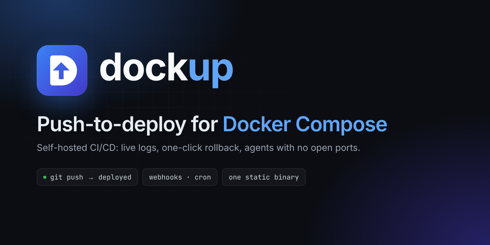

# Dockup

**Push-to-deploy for Docker Compose.** Dockup is a self-hosted CI/CD control plane for your Compose stacks: point it at a git repository or a folder on a server, and it builds and deploys with live logs, one-click rollback, webhooks and schedules, all from a clean web UI.

One small image runs as the **hub** (web UI and API) or as an **agent** on other servers. Agents dial *out* to the hub, so remote servers need no open ports.

## Highlights

- **Projects**: one Compose stack on one server, from a git repo/branch or a path on disk
- **Live console**: streaming logs folded by pipeline stage (checkout → pull → build → up → health → hooks), with secrets masked
- **Triggers**: manual, git webhooks (GitHub, Gitea, GitLab), cron schedules, git polling that deploys only when the branch moved
- **Rollback**: redeploy any earlier successful commit in one click
- **Agents**: deploy to any Linux host with Docker over a single outbound connection
- **Team access**: local accounts or SSO (GitHub, Google, any OIDC provider); admin, operator and viewer roles; audit log with CSV export
- **Secrets**: git tokens, SSH keys and inline env encrypted at rest (AES-256-GCM)
- **Guided first run**: a two-minute setup that checks the host and ships a sample stack
- **API**: personal API tokens for CI pipelines

## Quick start (hub)

```bash
docker run -d --name dockup --restart unless-stopped \
  -p 8100:8100 \
  -v /var/run/docker.sock:/var/run/docker.sock \
  -v /var/lib/dockup:/var/lib/dockup \
  -v /opt/stacks:/opt/stacks \
  ramizmohammad/dockup:latest

docker logs dockup        # prints the one-time setup code
```

Open `http://<server>:8100`, enter the setup code, create the admin account and follow the guide.

> **Mount paths 1:1.** Compose resolves relative bind mounts on the *host*, so the data directory and your stacks directory must use the same path inside and outside the container (as above).

### Docker Compose

```yaml
services:
  dockup:
    image: ramizmohammad/dockup:latest
    container_name: dockup
    restart: unless-stopped
    ports:
      - "8100:8100"
    environment:
      DOCKUP_DATA: /var/lib/dockup
      # DOCKUP_URL: https://deploy.example.com    # public URL, needed for SSO
      # DOCKUP_TRUST_PROXY: "1"                   # behind nginx / Caddy / Traefik
    volumes:
      - /var/run/docker.sock:/var/run/docker.sock
      - /var/lib/dockup:/var/lib/dockup
      - /opt/stacks:/opt/stacks
```

## Add another server (agent)

In the UI, go to **Servers → Add server** to get a token, then on the remote host:

```bash
docker run -d --name dockup-agent --restart unless-stopped \
  -v /var/run/docker.sock:/var/run/docker.sock \
  -v /var/lib/dockup-agent:/var/lib/dockup-agent \
  -v /opt/stacks:/opt/stacks \
  -e DOCKUP_HUB=https://deploy.example.com \
  -e DOCKUP_TOKEN=dks_your_token \
  -e DOCKUP_DATA=/var/lib/dockup-agent \
  ramizmohammad/dockup:latest agent
```

The agent connects out to the hub; the panel shows it online within seconds.

## Configuration

| Variable | Default | Description |
|---|---|---|
| `DOCKUP_ADDR` | `:8100` | Listen address inside the container |
| `DOCKUP_DATA` | `/var/lib/dockup` | State, logs, checkouts and the encryption key |
| `DOCKUP_URL` | from request | Public URL (SSO callbacks, notification links) |
| `DOCKUP_TRUST_PROXY` | off | `1` when behind a TLS reverse proxy |
| `DOCKUP_SECRET_KEY` | generated | Derive the encryption key from this value instead of `secret.key` |
| `DOCKUP_ADMIN_USER` / `DOCKUP_ADMIN_PASSWORD` | – | Create the first admin from config instead of the setup code |
| `DOCKUP_ADMIN_EMAIL` | – | Invite an SSO admin (binds on first sign-in with this verified email) |
| `DOCKUP_GITHUB_CLIENT_ID` / `_SECRET` | – | Sign in with GitHub |
| `DOCKUP_GOOGLE_CLIENT_ID` / `_SECRET` | – | Sign in with Google |
| `DOCKUP_OIDC_ISSUER` / `_CLIENT_ID` / `_CLIENT_SECRET` / `_NAME` | – | Any OIDC provider (Keycloak, Authentik, Okta, Entra…) |
| `DOCKUP_HUB` / `DOCKUP_TOKEN` | – | Agent mode: hub URL and server token |

Names from the earlier DeployHub releases (`DEPLOYHUB_*`) are still accepted.

## Security

- Dockup drives the host Docker daemon through the socket, which is **root-equivalent**: treat admin access to Dockup like root on those servers.
- Put TLS in front (Caddy, nginx, Traefik) and set `DOCKUP_URL` and `DOCKUP_TRUST_PROXY=1`.
- Back up `/var/lib/dockup` **including `secret.key`** (or set `DOCKUP_SECRET_KEY`); without it, stored credentials cannot be decrypted.
- The first admin needs a one-time setup code, logins are rate limited per IP and per account, builds never see Dockup's own secrets, and API and agent tokens are stored hashed.

## Tags

- `latest`: newest release
- `0.3.0`: pinned version

## Links

- Source and docs: https://github.com/RamizMohammad/dockup
- Issues and feature requests: https://github.com/RamizMohammad/dockup/issues
